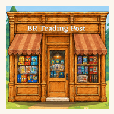

  

<h1 align="center">BR Trading Post</h1>

<a href="https://brtradingpost.co.uk/"><b>brtradingpost.co.uk</b></a>

## About

BR Trading Post is a small UK trading card shop. We sell Pokémon, One Piece, Disney Lorcana and Yu-Gi-Oh! cards, cards from other trading card games such as Magic: The Gathering and Digimon, and custom binders that we paint by hand.

Everything we sell is listed on [eBay](https://www.ebay.co.uk/usr/br_trading_post), so you buy with the checkout and buyer protection you already know. This website brings it all together in one place, and you can follow us on [TikTok](https://www.tiktok.com/@br_trading_post), [Instagram](https://www.instagram.com/br_trading_post/) and [Facebook](https://www.facebook.com/profile.php?id=61595112342609) for new stock and pulls.

## Features

- A shop with live stock from our eBay listings, checked every few minutes
- A page for every item, with photos, condition, item details and a link to buy it
- Sold items stay on the site with a Sold out banner, so you can see what we've had
- Pages for each game: Pokémon, One Piece, Disney Lorcana, Yu-Gi-Oh!, other card games and custom binders
- Search, filters and sorting
- Promotions with live countdowns
- Works like an app on phones, with a bottom navigation bar, and can be installed to your home screen
- Light and dark mode, or follow your device
- Fast, accessible (WCAG 2.2 AA) and works offline for pages you've visited

## Privacy

The site sets no cookies and has no advertising or tracking. Visitor numbers are counted with Cloudflare Web Analytics, which is cookieless and doesn't identify anyone. Full details are in the [privacy policy](https://brtradingpost.co.uk/privacy/).

## Credits

- [Literata](https://github.com/googlefonts/literata) and [Outfit](https://github.com/Outfitio/Outfit-Fonts) fonts ([SIL Open Font License](public/fonts/OFL.txt))
- Social and marketplace icons from [Simple Icons](https://simpleicons.org/) (CC0)
- Game logos from [Wikimedia Commons](https://commons.wikimedia.org/) (public domain). They remain trademarks of their owners and are shown only to identify the games we sell

## Legal

The BR Trading Post name, logo, shop illustration, photos and text belong to BR Trading Post, and all rights are reserved.

BR Trading Post is an independent shop. It is not affiliated with or endorsed by The Pokémon Company, Nintendo, Bandai, Disney, Ravensburger, Konami or Wizards of the Coast. Card names, images and game logos belong to their owners. eBay is a trademark of eBay Inc.
